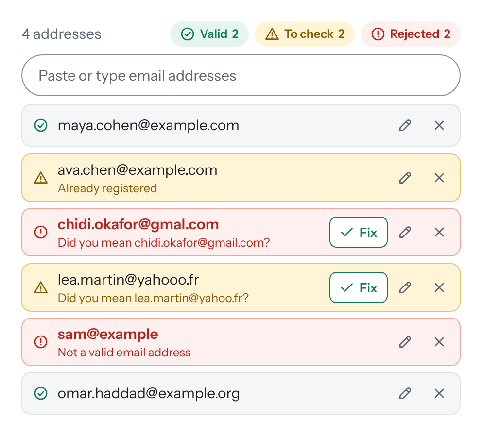

<div align="center">

# Goldpan

**New addresses for your list. Only the gold gets in.**

A tiny, dependency-free multiple email input for adding people to a list you already have: team members,
subscribers, guests. Paste the new addresses from anywhere and it spots who is already in, drops duplicates, offers a
one-click fix for misspelled domains (`gmial.com`), stops at the places left and keeps your form in sync.

[](https://www.npmjs.com/package/goldpan)
[](https://bundlephobia.com/package/goldpan)
[](https://github.com/molinariCode/goldpan/actions/workflows/ci.yml)
[](./src/types.ts)
[](./LICENSE)

**[Live demo & playground →](https://molinaricode.github.io/goldpan/)**



</div>

---

## Why Goldpan

Most "email tag inputs" only say whether an address is well formed. Adding people to a list you already have is
messier: a column copied from Excel, a line from Outlook with names in it, the same person twice, people who are
already members, a provider spelled wrong, more people than places left.

Gold panning is the same job: you pour in gravel and keep the nuggets. Goldpan gives every address exactly **one
status**:

| Status | Shown as | In `getEmails()` | Typical reasons |
| --- | --- | --- | --- |
| `valid` | green, *Valid* | ✅ | everything checks out |
| `warning` | amber, *To check* | ✅ (takes a place under `maxEmails`) | probable typo, already registered, your own rule's warning |
| `invalid` | red, *Rejected* | ❌ | malformed, excluded or certainly misspelled domain, no place left |

**Only red is left out.** Amber addresses are accepted and flagged so a person can take a second look.

## Features

- **Starts from your list**: addresses already on it (members, previous invites) are flagged for a check or
  refused (`existingEmails`)
- **Reads real lists**: commas, semicolons, spaces, line breaks, Excel columns, `Name <address>`
  (Outlook, Gmail, Apple Mail), `mailto:` links, full-width separators (`，` `；` `、`)
- **Typo check** for about 100 popular providers (`gmial.com`, `hotmial.com`, `gmail.con`…) with a one-click fix,
  tuned to leave real domains alone: regional ones like `hotmail.be` or `yahoo.in`, and companies such as `aon.com`
- **Limit of places** with `maxEmails`: when a place frees up, the first address waiting moves in
- **Duplicates** are dropped by default and the original is highlighted; or keep them with a warning, or refuse them
- **Exclusion list** of domains, with `*.domain` wildcards, ready for large disposable-domain lists
- **Your own rules** through a `validate` callback
- **Inline editing**, one-click filters by status and a counter with correct plurals
- **Nobody left out by surprise**: sending with rejected addresses first shows them, with a message; pressing again
  sends the others (or it stops until they are fixed, or goes on at once: the `rejected` option)
- **Form-friendly**: the original `<input>` always holds the accepted addresses, and a submit with rejected addresses
  works the same way; honours `required`, `disabled` and form reset
- **Accessible**: real buttons with names, `aria-pressed` filters, polite live region, `aria-invalid`, no keyboard
  traps, input methods (Chinese, Japanese, Android keyboards) handled, Windows high-contrast mode
- **Safe**: what users type or paste is never parsed as HTML
- **8 languages** included (en, it, es, fr, de, pt, zh, ja), easy to add more
- **Works anywhere**: plain pages, React, Vue, Svelte, shadow DOM, iframes; server-side rendering safe to import
- **Small**: about 10 kB of JavaScript and 2 kB of CSS gzipped, no dependencies, TypeScript types included

## Install

```bash
npm install goldpan
```

```js
import Goldpan from 'goldpan';
import 'goldpan/style.css';
```

Or with `<script>` tags, no build step:

```html
<link rel="stylesheet" href="https://cdn.jsdelivr.net/npm/goldpan@1/dist/goldpan.min.css">
<script src="https://cdn.jsdelivr.net/npm/goldpan@1/dist/goldpan.global.min.js"></script>
<!-- optional: languages -->
<script src="https://cdn.jsdelivr.net/npm/goldpan@1/dist/locales/it.global.min.js"></script>
```

## Quick start

```html
<label for="recipients">Recipients</label>
<input id="recipients" name="recipients" required>
```

```js
const pan = new Goldpan('#recipients', {
  maxEmails: 50,
  existingEmails: ['already@example.com'],
});

pan.on('change', ({ emails, counts, hasErrors }) => {
  console.log(emails); // accepted addresses (valid and to check), normalized
});
```

The original input is hidden and kept in sync (`"a@example.com, b@example.com"`), so a plain form submit just works.

## Options

| Option | Type | Default | Description |
| --- | --- | --- | --- |
| `maxEmails` | `number \| null` | `null` | Most accepted addresses (valid and to check). `null` = no limit. |
| `onLimit` | `'reject' \| 'drop'` | `'reject'` | Beyond the limit: show in red, or do not add. |
| `duplicates` | `'drop' \| 'warn' \| 'reject'` | `'drop'` | The same address twice. `drop` keeps the first one and highlights it; `warn` keeps both, flagged for a check, each taking a place; `reject` shows the copy in red. |
| `existingEmails` | `Iterable<string>` | `[]` | Addresses already registered on your side. |
| `existing` | `'warn' \| 'reject'` | `'warn'` | What to do with `existingEmails` matches. |
| `blockedDomains` | `Iterable<string>` | `Goldpan.blockedDomains` | Exclusion list, always red. Passing a list replaces the default ([see below](#exclusion-list)). |
| `typoCheck` | `'warn' \| 'reject' \| false` | `'warn'` | Probable misspellings of popular providers. Both policies offer the fix button. |
| `knownDomains` | `Iterable<string>` | `[]` | More correct domains for the typo check (also stops look-alikes from being reported). |
| `validate` | `(email) => null \| { status, message }` | – | Your own rule; return `'warning'` or `'invalid'` to flag an address. |
| `locale` | `string \| object` | `'en'` | Registered language code or a messages object. |
| `messages` | `object` | – | Replace single messages. |
| `placeholder` | `string` | original input, then locale | Placeholder of the text field. |
| `separator` | `string` | `', '` | Separator written into the original input. |
| `rejected` | `'ask' \| 'block' \| 'skip'` | `'ask'` | With rejected addresses, what `confirm()` and a form submit do: show them and go on at the next press, stop until they are fixed, or go on without them. [See below](#sending-with-rejected-addresses). |
| `inlineMessage` | `boolean` | `true` | Show the message about rejected addresses inside the widget; turn it off to show it next to your button. |
| `editable` | `'all' \| 'valid' \| 'invalid' \| 'none'` | `'all'` | Rows that show the edit button. |
| `showCounter` | `boolean` | `true` | Show the counter above the list. |
| `theme` | `'light' \| 'dark' \| 'auto'` | `'light'` | `auto` follows the operating system. |
| `className` | `string` | – | Extra class on the root element. |
| `disabled` | `boolean` | original input | Disable the widget. |
| `onChange` | `(state) => void` | – | Shortcut for `on('change')`. |

Every option can be changed later with `setOptions()`; statuses are recomputed at once.

## API

```ts
const pan = new Goldpan(target: string | HTMLElement, options?: GoldpanOptions);

pan.getEmails(): string[]                   // accepted (valid and to check)
pan.getEntries(status?): GoldpanEntry[]     // { id, email, raw, status, reason, message, suggestion }
pan.getCounts(): { valid, warning, invalid, admitted, remaining }
pan.hasErrors(): boolean
pan.getState(): { emails, entries, counts, hasErrors }

pan.add(text | string[]): GoldpanEntry[]    // parsed like a paste
pan.setValue(text | string[]): GoldpanEntry[] // replaces the whole list
pan.update(idOrEmail, text): GoldpanEntry | null
pan.remove(idOrEmail): boolean
pan.clear(): void

pan.confirm(): boolean                      // call it from your send button: true = go on
pan.setOptions(partial): void
pan.setFilter('all' | 'valid' | 'warning' | 'invalid'): void
pan.focus() / pan.enable() / pan.disable()
pan.destroy(): void                         // gives the original input back

pan.on(event, listener): () => void         // returns an unsubscribe function
pan.off(event, listener): void

Goldpan.init(selector, options): Goldpan[]
Goldpan.getInstance(element | selector): Goldpan | undefined
Goldpan.registerLocale(code, messages): void
Goldpan.parse(text): string[]
Goldpan.isValidFormat(email): boolean
```

`target` can be an `<input>` or `<textarea>` (recommended, kept in sync) or any container element.

### Events

| Event | Payload |
| --- | --- |
| `change` | `{ emails, entries, counts, hasErrors }` |
| `add` | `{ entries }` |
| `remove` | `{ entry }` |
| `update` | `{ before, after }` |
| `duplicate` | `{ dropped: string[] }` |
| `limit` | `{ rejected: string[] }` |
| `filter` | `{ filter }` |
| `confirm` | `{ state, message, label }`: a confirmation stopped on rejected addresses, changed or ended |

The same events are dispatched as DOM `CustomEvent`s on the original element, prefixed with `goldpan:`
(`goldpan:change`, `goldpan:add`…), so you can listen from anywhere:

```js
document.addEventListener('goldpan:change', (e) => console.log(e.detail.emails));
```

## Sending with rejected addresses

Call `confirm()` from the button that uses the list: `true` means the accepted addresses can go. While rejected
addresses are present, the `rejected` option decides:

| `rejected` | First press | Next press |
| --- | --- | --- |
| `'ask'` (default) | shows the rejected addresses and how many they are: `false` | goes on without them: `true` |
| `'block'` | shows them, asking to fix or remove them: `false` | the same, until they are fixed |
| `'skip'` | goes on without them: `true` | |

The widget writes the message above the list. To show it next to your button instead, as the demo does, turn
`inlineMessage` off and follow the `confirm` event: it carries the message and, while the next press goes on, a label
for your button (`'Ignore and send'`, in the language of the widget).

```js
const pan = new Goldpan('#to', { inlineMessage: false });

pan.on('confirm', ({ state, message, label }) => {
  note.textContent = message; // '' when nothing is pending
  sendButton.textContent = state === 'ask' ? label : 'Send';
});

sendButton.onclick = () => {
  if (pan.confirm()) send(pan.getEmails()); // accepted addresses only
};
```

A form submit counts as a confirmation too: with `'ask'` the first submit stops and the next one goes through, with
`'block'` native validation stops it. The message follows the list (it counts what is left and goes away when nothing
is rejected any more), and a second press right after the first one, a double click, does not count.

## Recipes

### Invitations for a plan with a fixed number of seats

```js
const pan = new Goldpan('#invite', {
  maxEmails: plan.seats - members.length, // places left
  existingEmails: members,                // shown as "Already registered"
});

inviteButton.onclick = async () => {
  if (!pan.confirm()) return; // rejected addresses: shown first, the next press goes on without them
  members.push(...(await sendInvites(pan.getEmails())));
  pan.clear();
  pan.setOptions({ maxEmails: plan.seats - members.length, existingEmails: members });
};
```

### Strict list: company domain only, no existing members

```js
new Goldpan('#invite', {
  existing: 'reject',
  existingEmails: currentMembers,
  validate: (email) =>
    email.endsWith('@acme.com') ? null : { status: 'invalid', message: 'Only @acme.com addresses' },
});
```

### Exclusion list

Addresses on these domains are always red. The built-in list (`DEFAULT_BLOCKED_DOMAINS` in
[`src/domains.ts`](./src/domains.ts)) holds misspellings so common they are certainly wrong (`gmal.com`,
`hotmial.com`…, still shown with the fix button) and well-known throw-away services (`mailinator.com`, `yopmail.com`…).

```js
// Extend it for every instance (before creating them)
Goldpan.blockedDomains.push('competitor.com', '*.tempmail.dev');

// Extend it for one instance
new Goldpan('#to', { blockedDomains: [...Goldpan.blockedDomains, 'competitor.com'] });

// Replace it, or turn it off
new Goldpan('#to', { blockedDomains: ['competitor.com'] });
new Goldpan('#to', { blockedDomains: [] });

// Change it at runtime
pan.setOptions({ blockedDomains: [...Goldpan.blockedDomains, 'new-spam.com'] });

// A large external list (e.g. the 4,000+ domains of disposable-email-domains)
new Goldpan('#to', { blockedDomains: new Set([...Goldpan.blockedDomains, ...bigList]) });
```

`*.domain.com` covers the domain and all its sub-domains; `*.xyz` a whole top-level domain. For rules a list cannot
express, use `validate`. A maintained list of throw-away domains:
[disposable-email-domains](https://github.com/disposable-email-domains/disposable-email-domains).

### Languages

```js
import Goldpan from 'goldpan';
import it from 'goldpan/locales/it';

Goldpan.registerLocale('it', it);
const pan = new Goldpan('#to', { locale: 'it' });

// or replace a few texts
new Goldpan('#to', { messages: { duplicate: 'Already invited' } });
```

Bundled: `en` (default), `it`, `es`, `fr`, `de`, `pt`, `zh`, `ja`. `goldpan/locales/all` exports every language.
With `<script>` tags, load `dist/locales/<code>.global.min.js` after the core.

The counter uses the plural rules of the language (`1 address`, `2 addresses`): a message can be a string or an
object with one text per plural category (`{ one: '…', other: '…' }`).

New languages are very welcome: copy `src/locales/en.ts`, translate, add it to `src/locales/all.ts`.

### React, Vue, Svelte…

Goldpan works on any input element. Create it after mount, destroy it on unmount:

```jsx
function Recipients({ onChange }) {
  const ref = useRef(null);
  useEffect(() => {
    const pan = new Goldpan(ref.current, { onChange: (s) => onChange(s.emails) });
    return () => pan.destroy();
  }, []);
  return <input ref={ref} name="recipients" />;
}
```

To set the list from outside (a saved draft, a "reset" button), call `pan.setValue(addresses)`.

## Styling

All classes start with `goldpan`. Customise with CSS variables:

```css
.goldpan {
  --goldpan-font: 'Inter', sans-serif;
  --goldpan-font-size: 1rem;                 /* every size of the widget follows it */
  --goldpan-radius: 6px;                     /* corners of the address cards */
  --goldpan-list-max-height: 240px;
  --goldpan-focus: #7c3aed;                  /* focus ring, highlighted card */
  --goldpan-fg: #1b1f24;   --goldpan-muted: #5b6470;
  --goldpan-bg: #ffffff;   --goldpan-row: #f5f6f8;  /* text box, address cards */
  --goldpan-line: #dfe3e8; --goldpan-edge: #838d99; /* card border, text box border */
  --goldpan-valid: #0f7a5a;   --goldpan-valid-soft: #e6f4ee;
  --goldpan-warning: #8a5a00; --goldpan-warning-soft: #fff4d6; --goldpan-warning-line: #e8c36b;
  --goldpan-invalid: #b42318; --goldpan-invalid-soft: #fef0ee; --goldpan-invalid-line: #f1a69d;
}
```

`theme: 'dark'` switches every colour to a dark set, `theme: 'auto'` follows the operating system. The default
colours pass WCAG AA contrast in both.

See [`src/goldpan.css`](./src/goldpan.css) for the full list.

## How addresses are judged

1. **Shape**: a practical check of what real mail systems accept, international addresses included. Quoted local
   parts and IP-address domains are refused on purpose.
2. **Exclusion list** (`blockedDomains`) → error; a misspelling on the list still gets the fix button.
3. **Typo check**: the domain is compared with about 100 popular providers. Two kinds of slip are recognised: in the
   provider name with the same ending (`gmial.com`, `libreo.it`), and in the ending with the same name
   (`gmail.con`, `hotmail.co`). A real country ending is a regional service and is left alone (`hotmail.be`); the
   first letter must match and very short names (`aol`, `gmx`) are compared only exactly, as they sit one letter
   away from many real company domains. Add your own with `knownDomains`.
4. **Your `validate` callback**.
5. **Duplicates**, then **existing** addresses, following their policy.
6. **Limit**: addresses are accepted in list order until `maxEmails` is reached.

Comparison ignores letter case; `getEmails()` returns lower-cased addresses. Goldpan checks the *shape* of an address,
not that the mailbox exists: always validate again on the server.

## Browser support

All evergreen browsers (Chrome, Edge, Firefox, Safari 14+). ES2020 output.

## Development

Node.js 22.18 or newer (the current LTS is recommended).

```bash
npm install
npm run dev          # builds the demo, opens it on http://localhost:5173, reloads it on every change
npm test             # unit tests (Vitest + jsdom)
npm run typecheck
npm run build        # dist/: ESM, CommonJS, <script> builds, types, CSS
npm run build:site   # site/: the demo as published (English, Italian in site/it/, sitemap), plus site/standalone.html (works offline)
npm run lint:package
```

`demo/index.html` is the source of the demo page: opened directly, it only explains how to start it.

## Support the project

Goldpan is free and open source (MIT). If it saves you time,
[give it a star on GitHub](https://github.com/molinariCode/goldpan): it helps others find it.

## License

[MIT](./LICENSE) © 2026 Michele Molinari
